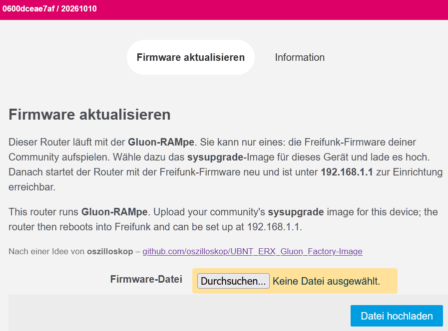
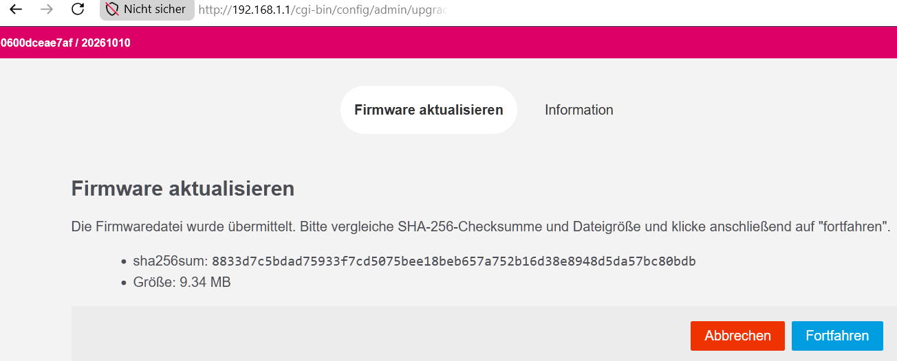

# AVM FRITZ!Box 7520: Freifunk-Firmware installieren

> **Noch nicht am Gerät erprobt.** Wichtige Schritte haben wir von
> ähnlichen Geräten oder aus dem OpenWrt-Wiki übernommen. Es sollte so klappen,
> aber sei aufmerksam und hör auf, wenn etwas anders aussieht als hier
> beschrieben.
> Den Ablauf beschreibt OpenWrt so; dass die RAMpe Bootloader und Speicher vorbereitet, ist im Testsystem geprüft, am Gerät noch nicht.
>
> Probier es aus und schreib uns, ob es geklappt hat. Und wenn es irgendwo
> hakt: Melde dich, wir helfen dir weiter. Jede Rückmeldung macht die
> Anleitung für alle nach dir besser:
>
> [projekt@neanderfunk.de](mailto:projekt@neanderfunk.de?subject=Anleitung%20AVM%20FRITZ%21Box%207520)

> **Danach ist FRITZ!OS weg.** Bei diesem Gerät ersetzt die Installation den
> Bootloader und entfernt die Firmware von AVM. Zurück geht es danach nur
> noch mit dem Wiederherstellungs-Programm von AVM (siehe unten).

Bei diesem Gerät geht es in drei Etappen, alle vom Rechner aus und ohne das
Gerät zu öffnen:

1. Über den Bootloader von AVM kommt ein neuer Bootloader (U-Boot) in den
   Arbeitsspeicher ([Der Bootloader von AVM (EVA)](grundlagen/avm-eva.md)).
2. Der holt sich per TFTP die **Gluon-RAMpe**: eine kleine Firmware, die nur
   eins kann, nämlich die Freifunk-Firmware deiner Community annehmen.
3. Auf der Seite der RAMpe lädst du die Freifunk-Firmware hoch. Die RAMpe
   bereitet den Speicher vor und schreibt dann die Freifunk-Firmware.

## Was du brauchst

- das Gerät mit Netzteil, einen Rechner mit Netzwerkanschluss und ein
  Netzwerkkabel
- Python 3 und das kleine Programm [eva_ramboot.py](https://raw.githubusercontent.com/openwrt/openwrt/a1ea57bd050c172fdc2b851824ebd9782aafb055/scripts/flashing/eva_ramboot.py) von OpenWrt
- einen TFTP-Server auf dem Rechner ([TFTP-Server einrichten](grundlagen/tftp-server.md))
- den Bootloader für dieses Gerät: [uboot-fritz7520.bin](https://download.ffnef.de/other/Gluon-Installer-RAMpe/uboot-fritz7520.bin)
- die RAMpe für dieses Gerät: [gluon-rampe-20261015-avm-fritz-box-7530-initramfs-uImage.itb](https://download.ffnef.de/other/Gluon-Installer-RAMpe/gluon-rampe-20261015-avm-fritz-box-7530-initramfs-uImage.itb)
- die Freifunk-Firmware deiner Community für dieses Gerät, und zwar das
  **sysupgrade**-Image

## Vorher prüfen

Die 7520 bekommt dieselbe RAMpe wie die 7530, aber ihren eigenen
Bootloader (`uboot-fritz7520.bin`) und den TFTP-Namen `FRITZ7520.bin`. Die
RAMpe erkennt sie an ihrer Hardware-Kennung (247).

**Offen:** Manche 7520 wurden durch Ändern der Hardware-Kennung zu einer 7530
umgestellt. So ein Gerät bekäme von der RAMpe den Bootloader der 7530. Ob das
passt, ist nicht belegt.

## Schritte

1. **Dateien bereitlegen.** eva_ramboot.py und `uboot-fritz7520.bin` in einen
   Ordner, dort ein Terminal öffnen. Die RAMpe in den Ordner des
   TFTP-Servers legen und **genau in `FRITZ7520.bin` umbenennen**.

2. **Rechner vorbereiten.** Feste Adresse `192.168.178.10`, Netzmaske
   `255.255.255.0` ([Feste IP-Adresse einstellen](grundlagen/feste-ip.md)).
   WLAN am Rechner aus. Kabel an eine LAN-Buchse des Geräts.

3. **Bootloader laden.** Strom an das Gerät, und sobald der Rechner eine
   Netzwerkverbindung anzeigt:

   ```
   python3 eva_ramboot.py --offset 0x85000000 192.168.178.1 uboot-fritz7520.bin
   ```

   Kommt eine Fehlermeldung, war das Zeitfenster vorbei: Strom ziehen und
   noch einmal.

4. **RAMpe per TFTP.** Stell den Rechner jetzt um auf die feste Adresse
   `192.168.1.70`, Netzmaske `255.255.255.0`, und starte den TFTP-Server.
   Der neue Bootloader fragt alle 5 Sekunden nach `FRITZ7520.bin`; der
   TFTP-Server zeigt, wenn die Datei abgeholt wird. Danach startet die RAMpe
   aus dem Arbeitsspeicher. Das dauert bis zu 2 Minuten.

5. **Die Seite der RAMpe.** Öffne `http://192.168.1.1/cgi-bin/config` (der
   Rechner kann auf `192.168.1.70` bleiben). Kommt "Not Found", hat sich der
   Browser eine Seite von früher gemerkt: Tipp die Adresse vollständig ein,
   mit `/cgi-bin/config` am Ende. Hilft das nicht, siehe [Der Browser zeigt "Not Found"](grundlagen/browser-not-found.md). Die Seite weist darauf hin, dass sie bei diesem
   Gerät den Speicher vorbereitet, den neuen Bootloader dauerhaft schreibt
   und die Firmware von AVM entfernt.

   

6. **Freifunk-Firmware hochladen.** Wähl das sysupgrade-Image deiner
   Community und klick "Datei hochladen". Die RAMpe zeigt die Prüfsumme
   (SHA256); vergleich sie mit der Angabe deiner Community und klick
   "Fortfahren".

   

7. **Warten.** Die RAMpe schreibt zuerst den Bootloader, entfernt die
   Firmware von AVM und schreibt dann die Freifunk-Firmware. **Strom nicht
   ziehen.**

8. **Fertig.** Stell den Rechner wieder auf "automatisch". Danach startet die
   Freifunk-Firmware deiner Community: je nach Community zuerst mit einer
   Einrichtungsseite unter `http://192.168.1.1` oder gleich im Betrieb.
   Kommt dort "Not Found", siehe [Der Browser zeigt
   "Not Found"](grundlagen/browser-not-found.md).

Tipp für Linux: Mit `ip addr add` kannst du dem Netzwerkanschluss beide
Adressen gleichzeitig geben (`192.168.178.10/24` und `192.168.1.70/24`);
dann entfällt das Umstellen in Schritt 4.

## Woran du erkennst, dass es geklappt hat

- eva_ramboot.py endet ohne Fehlermeldung.
- Der TFTP-Server zeigt, dass `FRITZ7520.bin` abgeholt wurde.
- Unter `http://192.168.1.1` erscheint die Seite der RAMpe.
- Nach Schritt 7 meldet sich die Freifunk-Firmware.

## Wenn etwas schiefgeht

- **eva_ramboot.py bekommt keine Verbindung.** Das Zeitfenster ist kurz.
  Strom ziehen, einstecken, sofort noch einmal. Ein einfacher Switch zwischen
  Gerät und Rechner hilft. Laut OpenWrt nehmen manche Geräte beim Start auch
  `192.168.1.1` statt `192.168.178.1`.
- **Der TFTP-Server meldet keine Anfrage.** Prüf die Adresse
  `192.168.1.70`, die Firewall und den Dateinamen `FRITZ7520.bin` (genau
  so, Groß- und Kleinschreibung zählt).
- **Die RAMpe meldet "Die Vorbereitung dieses Geräts ist fehlgeschlagen. Die
  Freifunk-Firmware wurde nicht aufgespielt."** Dann wurde nichts
  geschrieben. Schick uns bitte das Protokoll, das darunter steht, an
  [projekt@neanderfunk.de](mailto:projekt@neanderfunk.de).
- **Nach einem Abbruch startet das Gerät mit dem neuen Bootloader, aber ohne
  Freifunk-Firmware.** Dann einfach ab Schritt 4 noch einmal: Der neue
  Bootloader fragt beim Start wieder per TFTP nach der RAMpe.

## Zurück zu FRITZ!OS

Der Bootloader von AVM selbst bleibt unberührt. Mit dem
Wiederherstellungs-Programm von AVM (für Windows; auf dem Download-Server von
AVM im Ordner des Geräts unter "recover") lässt sich FRITZ!OS zurückspielen.
Laut OpenWrt hilft im Notfall die Version FRITZ!OS 7.21.

## Herkunft der Angaben

Die Angaben stammen aus diesen Quellen (in Klammern, wofür):

- abgeleitet (Weg ab Werk, Dauer)
- abgeleitet: OpenWrt-Wiki "AVM recovery tool" (Rückweg zur Herstellerfirmware)
- abgeleitet: Wiki (Typenschild/Verwechslung)
- abgeleitet: Wiki 7520/7530 (Schritte (Normalweg), Sichtbare Zeichen, Typenschild/Verwechslung)
- abgeleitet: Wiki 7520/7530, nur als Ausweg (Fehlerbild)
- abgeleitet: Wiki 7530 (Adressen)
- abgeleitet: dasselbe Wiki (Rückweg zur Herstellerfirmware)
- geprüft (Schritte (Normalweg))
- geprüft: Commit (Schritte (Normalweg), Sichtbare Zeichen, Anschluss, Adressen, Programm, Datei, Dauer)
- geprüft: Commit 95b0c07a (Schritte (Normalweg), Taste und Zeitpunkt)
- geprüft: Commit, U-Boot-Quelltext: serverip 192.168.1.70, bootfile FRITZ7520.bin (Schritte (Normalweg), Adressen, Programm, Datei)
- geprüft: Download-Liste 24.10.8 (Weg ab Werk)
- geprüft: U-Boot-Quelle chunkeey/FritzBox-4040-UBOOT, include/configs/fritz7520.h (Gluon-RAMpe-Rezept)
- geprüft: U-Boot-Quelltext chunkeey FritzBox-4040-UBOOT (Sichtbare Zeichen)
- geprüft: uboot-fritz4040/Makefile am Pin, U-Boot-Quelltext (Typenschild/Verwechslung)
- geprüft; abgeleitet (Schritte (Normalweg))
- Geräteeintrag: OpenWrt 95b0c07a618fe5fd93a26931152ced483bba143b
