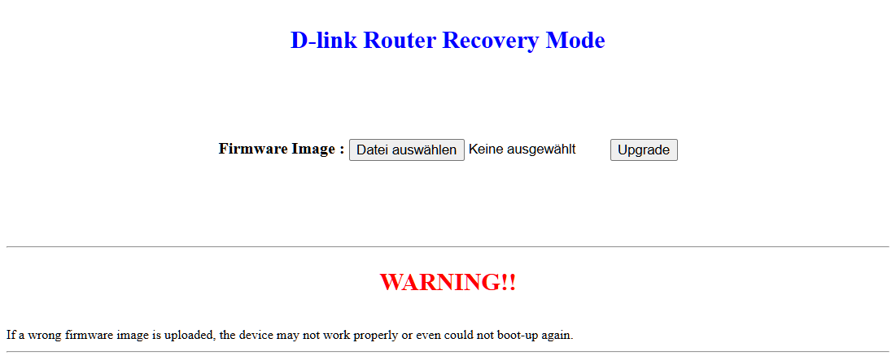
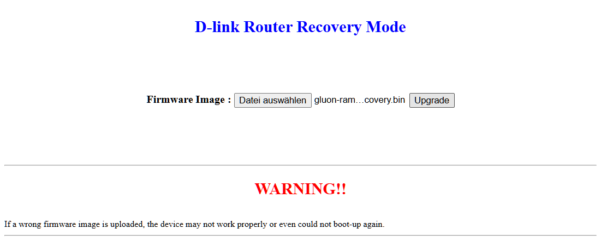
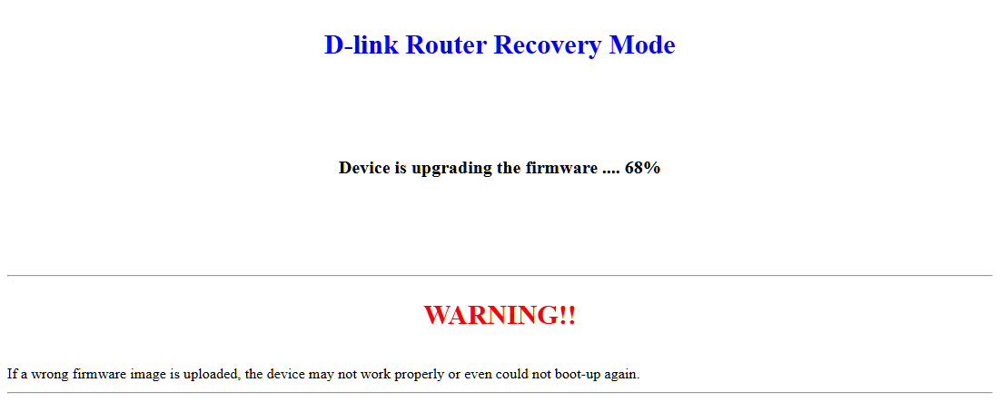
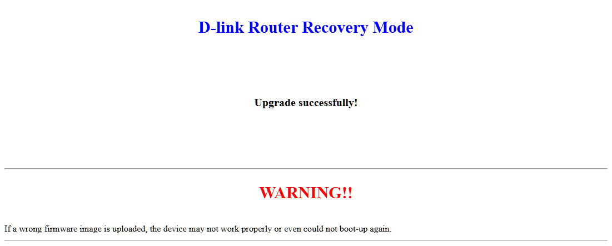
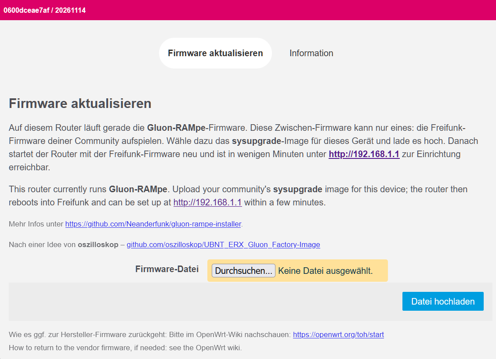
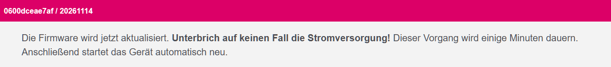

# D-Link AQUILA PRO AI M30 A1: Freifunk-Firmware installieren

> Schreib uns, ob es geklappt hat. Und wenn es irgendwo hakt: Melde dich,
> wir helfen dir weiter. Jede Rückmeldung macht die
> Anleitung für alle nach dir besser:
>
> [projekt@neanderfunk.de](mailto:projekt@neanderfunk.de?subject=Anleitung%20D-Link%20AQUILA%20PRO%20AI%20M30%20A1)

Der D-Link AQUILA PRO AI M30 A1 hat eine eingebaute Notfall-Seite von D-Link, die
**Recovery**. Sie nimmt eine Firmware-Datei an und schreibt sie in den
Speicher, auch wenn sonst nichts mehr geht. Über sie kommt zuerst die
**Gluon-RAMpe** auf den Router: eine kleine Seite, die nur eins kann, die
Freifunk-Firmware deiner Community annehmen. Du brauchst dafür kein SSH und
kein Passwort.

## Was du brauchst

- einen Rechner mit Netzwerkanschluss und ein Netzwerkkabel
- eine Büroklammer für die Reset-Taste
- die RAMpe-Datei für dieses Gerät: `gluon-rampe-<Datum>-d-link-aquila-pro-ai-m30-a1-recovery.bin` ([herunterladen](https://firmware.neanderfunk.de/other/Gluon-Installer-RAMpe/gluon-rampe-20261115-d-link-aquila-pro-ai-m30-a1-recovery.bin))
- die Freifunk-Firmware deiner Community für den D-Link AQUILA PRO AI M30 A1, und zwar das
  **sysupgrade**-Image
- zum Hochladen den Browser **Chrome oder Chromium** (Firefox geht hier nicht)

WLAN am Rechner schaltest du für die Installation am besten aus, damit er
wirklich über das Kabel spricht.

## Schritte

1. **Dateien bereitlegen.** Lade die RAMpe-Datei und das sysupgrade-Image herunter und leg sie in einen
   Ordner, den du wiederfindest, zum Beispiel "Downloads".

2. **Feste Adresse am Rechner.** Stell den Netzwerkanschluss deines Rechners
   auf die feste Adresse `192.168.200.10` mit der Netzmaske
   `255.255.255.0`. Ein Gateway brauchst du nicht. Wie das geht, steht unter
   [Feste IP-Adresse einstellen](grundlagen/feste-ip.md).

3. **Kabel stecken.** Verbinde den Rechner mit dem Router, und zwar mit einer der LAN-Buchsen, nicht mit WAN. **An der WAN-Buchse funktioniert die Recovery nicht.**
   Der Router hat noch keinen Strom.

4. **Router in die Recovery bringen.** Drück mit der Büroklammer die
   Reset-Taste und halte sie gedrückt. Steck jetzt den Strom ein und halte
   die Taste weiter, bis die LED **rot blinkt, etwa zweimal pro Sekunde**. Dann loslassen.
   Ein orangefarbenes Auf- und Abdimmen ist nicht die Recovery. Dann Strom ab und noch einmal.

5. **Recovery-Seite öffnen.**
   Öffne in Chrome oder Chromium `http://192.168.200.1`. Es erscheint die Recovery-Seite von D-Link.
   Kommt gar nichts, prüf die feste Adresse (Schritt 2) und das Kabel
   (Schritt 3). Ein `ping` hilft hier nicht, die Recovery antwortet nicht
   darauf.

   

6. **Datei im Browser hochladen.** Klick auf "Datei auswählen", wähl die RAMpe-Datei `gluon-rampe-<Datum>-d-link-aquila-pro-ai-m30-a1-recovery.bin` und klick "Upgrade".

   
   
   Die Seite zeigt jetzt "Device is upgrading the firmware" mit einer Prozentzahl. Das Hochladen geht langsam. Lass die Seite in Ruhe, bis "Upgrade successfully!" erscheint.

   

7. **Warten.** Danach schreibt die Recovery die Datei in den Speicher; dabei leuchtet die LED ruhig rot, etwas schwächer, und
   der Router startet neu (beim Neustart flackert die LED schnell weiß).
   **Strom nicht ziehen.** Die Erfolgsmeldung allein heißt noch nicht,
   dass es geklappt hat.

   
   
   Nicht geklappt hat es, wenn

   - gar nichts passiert: Der Router bleibt in der Recovery, die LED blinkt
     weiter wie in Schritt 4, oder
   - der Router mit der normalen D-Link-Firmware startet (die LED dimmt langsam orange auf und ab).

   Dann ist die Datei nicht angekommen. Das ist harmlos: noch einmal ab
   Schritt 4 mit Chrome oder Chromium. Klappt es auch dann nicht, nimm den Notweg
   weiter unten ("Notweg: Hochladen mit curl").

8. **Die RAMpe.** Nach dem Neustart blinkt die LED weiß und gleichmäßig, etwa einmal pro Sekunde. Stell den Rechner
   wieder auf "automatisch" (DHCP) und öffne
   `http://192.168.1.1`. Die RAMpe leitet von selbst auf ihre Seite
   "Firmware aktualisieren" weiter. Kommt stattdessen "Not Found", hat sich der Browser eine Weiterleitung von früher gemerkt, siehe [Der Browser zeigt "Not Found"](grundlagen/browser-not-found.md). Kommt gar nichts, siehe [Die Router-Seite antwortet nicht](grundlagen/router-antwortet-nicht.md).
   Die RAMpe bleibt auf dem Router, bis die Freifunk-Firmware sie ersetzt.
   Startet der Router zwischendurch neu, ist das harmlos: Seite einfach
   wieder aufrufen.
   Zeigt der Browser stattdessen eine Warnung vor einem unsicheren
   Zertifikat, hat er von sich aus `https://` vor die Adresse gesetzt. Klick
   auf "Erweitert" und "Trotzdem fortfahren" (je nach Browser etwas anders
   benannt), dann kommt die Seite. Mehr dazu unter
   [Browser macht https daraus](grundlagen/browser-https.md).

   

9. **Freifunk-Firmware hochladen.** Wähl das sysupgrade-Image deiner
   Community aus und klick "Datei hochladen". Die RAMpe zeigt die Prüfsumme
   (SHA256) der Datei. Vergleich sie mit der Prüfsumme, die deine Community
   zur Datei angibt. Stimmt sie, klick "Fortfahren".

   

   Danach erscheint der Hinweis, dass die Firmware jetzt geschrieben wird.
   Jetzt den Strom nicht unterbrechen.

   

10. **Fertig.** Nach wenige Minuten startet die Freifunk-Firmware
    deiner Community: je nach Community zuerst mit einer Einrichtungsseite
    unter `http://192.168.1.1` oder gleich im Betrieb.
    Antwortet dort nichts, siehe [Die Router-Seite antwortet
    nicht](grundlagen/router-antwortet-nicht.md); kommt "Not Found", siehe
    [Der Browser zeigt "Not Found"](grundlagen/browser-not-found.md). Wie es weitergeht,
    beschreibt deine Community.

## Woran du erkennst, dass es geklappt hat

- Nach dem Neustart blinkt die LED weiß und gleichmäßig, etwa einmal pro Sekunde, und `http://192.168.1.1` zeigt
  die Seite "Firmware aktualisieren".
- Die Erfolgsmeldung der D-Link-Seite zählt nicht, sie erscheint immer.

## Wenn etwas schiefgeht

- **Der Router bleibt in der Recovery (die LED blinkt weiter wie in
  Schritt 4), oder er startet mit der normalen D-Link-Firmware (die LED dimmt langsam orange auf und ab).**
  Dann ist die Datei nicht angekommen. Mit Firefox passiert das immer.
  Noch einmal ab Schritt 4 mit Chrome oder Chromium, sonst den Notweg mit curl
  (unten). Im Notweg ist die häufigste Ursache ein Tippfehler im
  Dateinamen.
- **Im Notweg: curl meldet "Failed to connect", HTTP 000 und 0 Bytes.** Die Recovery war
  nicht erreichbar. Prüf die feste Adresse (Schritt 2) und das Kabel (Schritt 3), dann
  Router noch einmal in die Recovery bringen (Schritt 4).
- **Im Notweg: curl steht bei 100 % und kommt nicht zurück, oder meldet nach langer
  Zeit "Recv failure: Connection timed out".** Das ist normal: Der Router hat
  neu gestartet, ohne curl Bescheid zu geben. curl darf mit Strg+C beendet
  werden, sobald der Router neu startet.
- **Im Notweg: Aus der WSL unter Windows kommt keine Verbindung zustande.** Nimm curl.exe
  direkt in Windows, nicht in der WSL.

## Notweg: Hochladen mit curl

Nur wenn das Hochladen im Browser nicht klappt. Du brauchst dafür das
Programm **curl**. Unter Linux und macOS ist es meist schon da, unter
Windows 10 und 11 heißt es `curl.exe` und ist eingebaut
([curl benutzen](grundlagen/curl.md)).

1. **Router wieder in die Recovery bringen** wie in Schritt 4 und 5, aber
   dort nichts hochladen.
2. **Datei mit curl hochladen.** Öffne ein Terminal (unter Windows die
   **PowerShell**), wechsle in den Ordner mit der Datei und gib ein:

   Linux und macOS:

   ```sh
   curl -H "Expect:" -w "HTTP %{http_code}, hochgeladen %{size_upload} Bytes\n" -o /dev/null -F "firmware=@gluon-rampe-20261115-d-link-aquila-pro-ai-m30-a1-recovery.bin;type=application/octet-stream" http://192.168.200.1/upload.cgi
   ```

   Windows (PowerShell):

   ```
   curl.exe -H "Expect:" -w "HTTP %{http_code}, hochgeladen %{size_upload} Bytes\n" -o antwort.bin -F "firmware=@gluon-rampe-20261115-d-link-aquila-pro-ai-m30-a1-recovery.bin;type=application/octet-stream" http://192.168.200.1/upload.cgi
   ```

   Den echten Dateinamen statt `gluon-rampe-20261115-d-link-aquila-pro-ai-m30-a1-recovery.bin` einsetzen. Unter
   Windows `curl.exe` genau so ausschreiben; `antwort.bin` nimmt nur die
   Antwort des Routers auf und kann danach weg. Mehr unter
   [curl benutzen](grundlagen/curl.md).

3. **Warten.** curl zeigt beim Hochladen eine Fortschrittsanzeige. Bei 100 %
   ist die Datei drüben, das dauert meist nur Sekunden. Danach schreibt die
   Recovery sie in den Speicher; dabei leuchtet die LED ruhig rot, etwas schwächer.
   Bis zum Neustart vergehen meist einige Minuten.
   **Strom nicht ziehen.**
   Oft kommt curl danach nicht von selbst zurück, obwohl alles geklappt hat.
   Dann beende es mit **Strg+C** (am Mac ctrl+C), aber erst, wenn der Router
   neu startet (beim Neustart flackert die LED schnell weiß).
   Wartest du stattdessen, kommt curl nach einiger Zeit (gut 10
   Minuten) von selbst zurück, meist mit "Recv failure: Connection timed
   out". Das ist in Ordnung. Entscheidend ist die letzte Zeile, sie
   zeigt, wie viel ankam. Geklappt hat es bei **etwa 52,4 Millionen Bytes**.
   Steht da 0, kam nichts an (siehe "Wenn etwas schiefgeht").

Danach weiter mit Schritt 8 oben.
