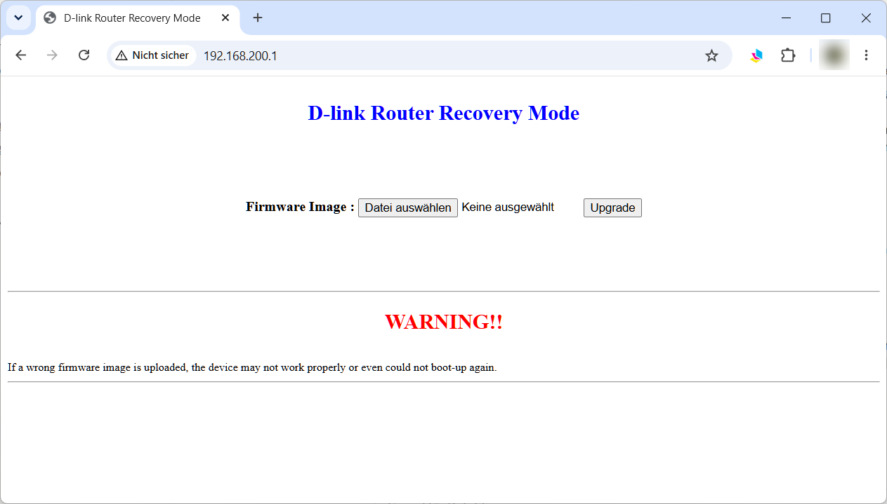
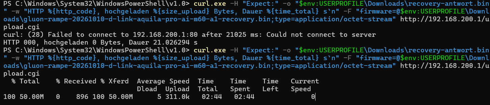

# D-Link AQUILA PRO AI M60 A1: Freifunk-Firmware installieren

> **Am Gerät erprobt** am 16.10.2026 mit `gluon-rampe-20261015-d-link-aquila-pro-ai-m60-a1-recovery.bin`.
>
> Probier es aus und schreib uns, ob es geklappt hat. Und wenn es irgendwo
> hakt: Melde dich, wir helfen dir weiter. Jede Rückmeldung macht die
> Anleitung für alle nach dir besser:
>
> [projekt@neanderfunk.de](mailto:projekt@neanderfunk.de?subject=Anleitung%20D-Link%20AQUILA%20PRO%20AI%20M60%20A1)

Der D-Link AQUILA PRO AI M60 A1 hat eine eingebaute Notfall-Seite von D-Link, die
**Recovery**. Sie nimmt eine Firmware-Datei an und schreibt sie in den
Speicher, auch wenn sonst nichts mehr geht. Über sie kommt zuerst die
**Gluon-RAMpe** auf den Router: eine kleine Seite, die nur eins kann, die
Freifunk-Firmware deiner Community annehmen. Du brauchst dafür kein SSH und
kein Passwort.

## Was du brauchst

- einen Rechner mit Netzwerkanschluss und ein Netzwerkkabel
- eine Büroklammer für die Reset-Taste
- die RAMpe-Datei für dieses Gerät: `gluon-rampe-<Datum>-d-link-aquila-pro-ai-m60-a1-recovery.bin` ([herunterladen](https://download.ffnef.de/other/Gluon-Installer-RAMpe/gluon-rampe-20261015-d-link-aquila-pro-ai-m60-a1-recovery.bin))
- die Freifunk-Firmware deiner Community für den D-Link AQUILA PRO AI M60 A1, und zwar das
  **sysupgrade**-Image
- das Programm **curl** zum Hochladen. Unter Linux und macOS ist es meist
  schon da, unter Windows 10 und 11 heißt es `curl.exe` und ist eingebaut
  ([curl benutzen](grundlagen/curl.md)).

WLAN am Rechner schaltest du für die Installation am besten aus, damit er
wirklich über das Kabel spricht.

## Schritte

1. **Dateien bereitlegen.** Lade die RAMpe-Datei und das sysupgrade-Image herunter und leg sie in einen
   Ordner, den du wiederfindest, zum Beispiel "Downloads".

2. **Feste Adresse am Rechner.** Stell den Netzwerkanschluss deines Rechners
   auf die feste Adresse `192.168.200.66` mit der Netzmaske
   `255.255.255.0`. Ein Gateway brauchst du nicht. Wie das geht, steht unter
   [Feste IP-Adresse einstellen](grundlagen/feste-ip.md).

3. **Kabel stecken.** Verbinde den Rechner mit dem Router, und zwar mit einer der LAN-Buchsen, nicht mit WAN.
   Der Router hat noch keinen Strom.

4. **Router in die Recovery bringen.** Drück mit der Büroklammer die
   Reset-Taste und halte sie gedrückt. Steck jetzt den Strom ein und halte
   die Taste weiter, bis die LED **rot blinkt**. Dann loslassen.
   Nur die Reset-Taste führt in die Recovery, keine der anderen Tasten.
   Ein orangefarbenes Auf- und Abdimmen ist nicht die Recovery. Dann Strom ab und noch einmal.

5. **Prüfen, ob die Recovery da ist.**
   Öffne im Browser `http://192.168.200.1`. Es erscheint eine schlichte Seite
   "D-link Router Recovery Mode".
   **Lade dort nichts hoch.** Ihr Fortschrittsbalken läuft nur nach der Uhr
   und sagt nichts darüber, ob die Datei ankam. Die Seite zeigt dir nur, dass
   die Recovery bereit ist.
   Kommt stattdessen eine aufwendigere Seite, die nach einem Passwort fragt,
   ist das die normale D-Link-Firmware, nicht die Recovery: zurück zu
   Schritt 4.
   Ein `ping` hilft hier nicht, die Recovery antwortet nicht darauf.

   

6. **Datei mit curl hochladen.** Öffne ein Terminal (unter Windows die
   **PowerShell**), wechsle in den Ordner mit der Datei und gib ein:

   Linux und macOS:

   ```sh
   curl -H "Expect:" -w "HTTP %{http_code}, hochgeladen %{size_upload} Bytes\n" -o /dev/null -F "firmware=@gluon-rampe-20261015-d-link-aquila-pro-ai-m60-a1-recovery.bin;type=application/octet-stream" http://192.168.200.1/upload.cgi
   ```

   Windows (PowerShell):

   ```
   curl.exe -H "Expect:" -w "HTTP %{http_code}, hochgeladen %{size_upload} Bytes\n" -o antwort.bin -F "firmware=@gluon-rampe-20261015-d-link-aquila-pro-ai-m60-a1-recovery.bin;type=application/octet-stream" http://192.168.200.1/upload.cgi
   ```

   Den echten Dateinamen statt `gluon-rampe-20261015-d-link-aquila-pro-ai-m60-a1-recovery.bin` einsetzen. Unter
   Windows `curl.exe` genau so ausschreiben; `antwort.bin` nimmt nur die
   Antwort des Routers auf und kann danach weg. Mehr unter
   [curl benutzen](grundlagen/curl.md).

7. **Warten.** curl zeigt beim Hochladen eine Fortschrittsanzeige. Bei 100 %
   ist die Datei drüben, das dauert meist nur Sekunden. Danach schreibt die
   Recovery sie in den Speicher; dabei leuchtet die LED ruhig rot, etwas schwächer.
   Bis zum Neustart vergehen meist weniger als eine halbe Minute bis gut 2 Minuten.
   **Strom nicht ziehen.**
   Oft kommt curl danach nicht von selbst zurück, obwohl alles geklappt hat.
   Dann beende es mit **Strg+C** (am Mac ctrl+C), aber erst, wenn der Router
   neu startet (beim Neustart blinkt die LED schnell weiß).
   Wartest du stattdessen, kommt curl nach einiger Zeit (bei uns gut 10
   Minuten) von selbst zurück, meist mit "Recv failure: Connection timed
   out". Das ist in Ordnung. Entscheidend ist die letzte Zeile, sie
   zeigt, wie viel ankam. Geklappt hat es bei **etwa 52,4 Millionen Bytes**.
   Steht da 0, kam nichts an (siehe "Wenn etwas schiefgeht").

8. **Die RAMpe.** Nach dem Neustart blinkt die LED weiß und gleichmäßig, etwa einmal pro Sekunde. Stell den Rechner
   wieder auf "automatisch" (DHCP) und öffne
   `http://192.168.1.1/cgi-bin/config`. Es erscheint die Seite "Firmware
   aktualisieren". Kommt "Not Found", hat sich der Browser eine Seite von
   früher gemerkt: Tipp die Adresse vollständig ein, mit `/cgi-bin/config` am
   Ende. Hilft das nicht, siehe [Der Browser zeigt "Not Found"](grundlagen/browser-not-found.md). Kommt gar nichts, siehe [Die Router-Seite antwortet nicht](grundlagen/router-antwortet-nicht.md).
   Die RAMpe bleibt auf dem Router, bis die Freifunk-Firmware sie ersetzt.
   Startet der Router zwischendurch neu, ist das harmlos: Seite einfach
   wieder aufrufen.
   Zeigt der Browser stattdessen eine Warnung vor einem unsicheren
   Zertifikat, hat er von sich aus `https://` vor die Adresse gesetzt. Klick
   auf "Erweitert" und "Trotzdem fortfahren" (je nach Browser etwas anders
   benannt), dann kommt die Seite. Mehr dazu unter
   [Browser macht https daraus](grundlagen/browser-https.md).

   

9. **Freifunk-Firmware hochladen.** Wähl das sysupgrade-Image deiner
   Community aus und klick "Datei hochladen". Die RAMpe zeigt die Prüfsumme
   (SHA256) der Datei. Vergleich sie mit der Prüfsumme, die deine Community
   zur Datei angibt. Stimmt sie, klick "Fortfahren".

   

   Danach erscheint der Hinweis, dass die Firmware jetzt geschrieben wird.
   Jetzt den Strom nicht unterbrechen.

   

10. **Fertig.** Nach unter 2 Minuten startet die Freifunk-Firmware
    deiner Community: je nach Community zuerst mit einer Einrichtungsseite
    unter `http://192.168.1.1` oder gleich im Betrieb.
    Antwortet dort nichts, siehe [Die Router-Seite antwortet
    nicht](grundlagen/router-antwortet-nicht.md); kommt "Not Found", siehe
    [Der Browser zeigt "Not Found"](grundlagen/browser-not-found.md). Wie es weitergeht,
    beschreibt deine Community.

## Woran du erkennst, dass es geklappt hat

- curl hat beim Hochladen 100 % erreicht. Kommt es von selbst zurück,
  meldet es **etwa 52,4 Millionen Bytes**. Wie lange das gedauert hat, ist
  egal, es zählt die Menge.

  
- Nach dem Neustart blinkt die LED weiß und gleichmäßig, etwa einmal pro Sekunde, und unter
  `http://192.168.1.1/cgi-bin/config` steht "Firmware aktualisieren".
- Die Erfolgsmeldung der D-Link-Seite zählt nicht, sie erscheint immer.

## Wenn etwas schiefgeht

- **curl meldet "Failed to connect", HTTP 000 und 0 Bytes.** Die Recovery war
  nicht erreichbar. Prüf die feste Adresse (Schritt 2) und das Kabel, dann
  Router noch einmal in die Recovery bringen (Schritt 4).
- **curl steht bei 100 % und kommt nicht zurück, oder meldet nach langer
  Zeit "Recv failure: Connection timed out".** Das ist normal: Der Router hat
  neu gestartet, ohne curl Bescheid zu geben. curl darf mit Strg+C beendet
  werden, sobald der Router neu startet (Schritt 7).
- **Nach dem Upload startet wieder die normale D-Link-Firmware.** Die Datei
  ist nicht vollständig angekommen, zum Beispiel wegen eines Tippfehlers im
  Dateinamen. Das ist harmlos: noch einmal ab Schritt 4.
- **Der Browser-Upload war nach einer Sekunde "fertig".** Dann ist nichts
  übertragen worden. Das passiert auch in Chromium-Browsern. Nimm curl.
- **Aus der WSL unter Windows kommt keine Verbindung zustande.** Nimm curl.exe
  direkt in Windows, nicht in der WSL.
- **Die LED bleibt nach dem Upload rot, oder der Router hängt beim Start.**
  Der M60 hat zwei Speicherbereiche für die Firmware. Die Recovery schreibt in
  den gerade aktiven, die Freifunk-Firmware startet aber nur aus dem ersten. War der zweite
  aktiv, braucht es vorher ein Umschalt-Image ("M60-Recovery-UBI-Switch" von
  RolandoMagico auf GitHub), das genauso über die Recovery hochgeladen wird.
  Das ist ein Weg für Fortgeschrittene; frag im Zweifel deine Community. Bei
  unserem Test war es nicht nötig.

## Gut zu wissen

- **Mehrfach-Packs:** Geräte aus Mehrfach-Packs (auf dem Typenschild "M60-2")
  speichern ihre MAC-Adresse an anderer Stelle. Die RAMpe zeigt deshalb eine
  falsche Adresse, die mit `06:00:` beginnt. Gluon ohne Korrektur übernimmt
  diese falsche Adresse. Die Neanderfunk-Firmware enthält die Korrektur und
  liest beim ersten Start die Adresse vom Aufkleber. Frag deine Community, ob
  ihre Firmware das auch tut.
- **Über die normale D-Link-Oberfläche** lässt sich der M60 nicht auf
  Freifunk umstellen, nur über die Recovery.

## Herkunft der Angaben

Die Angaben stammen aus diesen Quellen (in Klammern, wofür):

- abgeleitet (Gluon-RAMpe passt, Gluon-RAMpe-Rezept)
- geprüft, am Gerät 29./30.09.2026 erprobt (Weg ab Werk, Schritte (Normalweg), Datei)
- geprüft: Commit (Schritte (Normalweg), Sichtbare Zeichen, Bedingung an die Herstellerfirmware, Fehlerbild)
- geprüft: Commit 7271ee5 (Sichtbare Zeichen, Bedingung an die Herstellerfirmware, Rückweg zur Herstellerfirmware)
- geprüft: Commit 7271ee5, am Gerät (Schritte (Normalweg), Adressen)
- geprüft: Commits 'Chromium based'; Firefox abgeleitet: Forum Darmstadt laut Notiz (Programm)
- geprüft: Commits 29cca6c, 7271ee5; Neanderfunk-Notiz (Schritte (Normalweg), Taste und Zeitpunkt)
- geprüft: Neanderfunk-Notiz (Schritte (Normalweg), Sichtbare Zeichen, Adressen, Zugang, Datei, Bedingung an die Herstellerfirmware, Dauer)
- geprüft: Neanderfunk-Notiz 13.10.2026, am Gerät (Taste und Zeitpunkt, Sichtbare Zeichen, Adressen, Programm, Dauer, Fehlerbild, Notweg, Hardware-Test, Gluon-RAMpe passt)
- geprüft: Neanderfunk-Notiz 15.10.2026, am Gerät (Anschluss, Notweg)
- geprüft: Neanderfunk-Notiz, am Gerät bestätigt (Typenschild/Verwechslung)
- geprüft: Neanderfunk-Notiz, am M60 erprobt (Programm)
- Geräteeintrag: OpenWrt 7271ee587cd104d30d6d46dd3c623c9d4602bd0c
