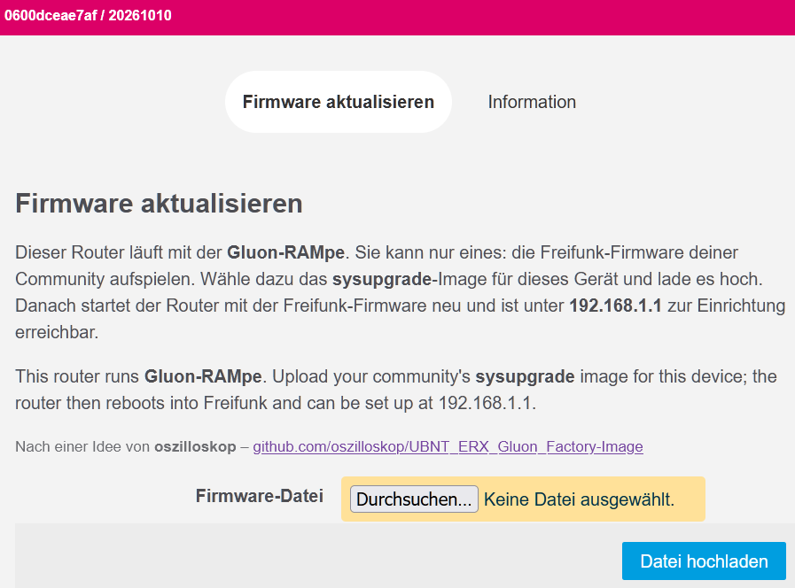

# Genexis/Inteno Pulse EX400: Freifunk-Firmware installieren

> **Am Gerät erprobt** am 11.11.2026 mit `gluon-rampe-20261015-genexis-pulse-ex400-factory.bin`. Das aktuelle Image ist neuer und in dieser Form
> noch nicht am Gerät gelaufen.
>
> Probier es aus und schreib uns, ob es geklappt hat. Und wenn es irgendwo
> hakt: Melde dich, wir helfen dir weiter. Jede Rückmeldung macht die
> Anleitung für alle nach dir besser:
>
> [projekt@neanderfunk.de](mailto:projekt@neanderfunk.de?subject=Anleitung%20Genexis/Inteno%20Pulse%20EX400)

Diese Anleitung ist für einen Pulse EX400 von **Genexis** oder **Inteno**
(Inteno heißt heute Genexis, die Geräte sind gleich). Der Router hat einen
eingebauten Notfall-Modus, über den du ohne Passwort eine neue Firmware
aufspielen kannst. Das geht in zwei Etappen, beide im Browser:

1. **Die Gluon-RAMpe aufspielen.** Über den Notfall-Modus lädst du die
   RAMpe hoch: eine kleine Firmware, die nur eins kann, nämlich die
   Freifunk-Firmware deiner Community annehmen.
2. **Die Freifunk-Firmware aufspielen.** Auf der Seite der RAMpe lädst du
   die Freifunk-Firmware deiner Community hoch.

Ein Terminal brauchst du nicht. Rechne mit einer Viertelstunde.

## Was du brauchst

- den Router mit Netzteil, einen Rechner mit Netzwerkanschluss und ein
  Netzwerkkabel
- diese zwei Dateien:
  1. die RAMpe für den EX400:
     [gluon-rampe-20261114-genexis-pulse-ex400-factory.bin](https://firmware.neanderfunk.de/other/Gluon-Installer-RAMpe/gluon-rampe-20261114-genexis-pulse-ex400-factory.bin), SHA256 `d50f3e886d82806b7c6480b395b07bc0770e48a0c40f8d7300ffd694903ebf0c`.
     Nimm genau diese Datei (sie endet auf `-factory.bin`), nicht die
     RAMpe mit `initramfs` im Namen.
  2. die Freifunk-Firmware deiner Community für den Genexis/Inteno Pulse EX400, und zwar
     das **sysupgrade**-Image. Ein factory-Image gibt es für dieses Gerät
     nicht.

## Vorher prüfen

- Steht auf dem Gerät **DNA** (finnischer Anbieter, "DNA Valokuitu Plus
  EX400", mit einer LED "Update" statt "WPS")? Dann passt diese Anleitung
  nicht: Für diese Variante gibt es keine Freifunk-Firmware.

## Schritte

### Teil 1: Die RAMpe über den Notfall-Modus aufspielen

1. **Feste Adresse am Rechner.** Stell deinen Rechner auf
   `192.168.1.10`, Netzmaske `255.255.255.0`
   ([Feste IP-Adresse einstellen](grundlagen/feste-ip.md)). Nur
   `192.168.1.1` darf es nicht sein, die nimmt der Router.

2. **Kabel an LAN.** Steck das Kabel vom Rechner in eine **LAN**-Buchse des
   Routers (nicht in WAN).

3. **Notfall-Modus starten.** Zieh den Stecker des Netzteils. Halt die
   **Reset**-Taste gedrückt und steck das Netzteil wieder ein. Halt die
   Taste weiter, bis die **Status-LED orange** und die **WPS-LED grün**
   leuchtet. Dann loslassen. **Danach die Reset-Taste nicht noch einmal
   drücken:** Im Notfall-Modus schaltet ein Druck zwischen den beiden
   Systemen auf dem Router um.

4. **Notfall-Seite öffnen.** Öffne im Browser `http://192.168.1.1`. Es
   erscheint eine schlichte Seite mit einem Feld zum Hochladen einer
   Firmware. Je nach Version des Bootloaders sieht sie etwas anders aus.

5. **RAMpe hochladen.** Wähl `gluon-rampe-20261114-genexis-pulse-ex400-factory.bin` aus und lad sie hoch.
   Warte, bis eine Bestätigungsseite erscheint.

6. **Neustart abwarten.** Der Router schreibt die RAMpe und startet neu.
   Strom nicht ziehen. Die RAMpe ist bereit, wenn der Router gleichmäßig
   blinkt, etwa einmal pro Sekunde.

### Teil 2: Freifunk-Firmware aufspielen

7. **Seite der RAMpe öffnen.** Öffne `http://192.168.1.1`. Die RAMpe leitet
   von selbst auf ihre Seite "Firmware aktualisieren" weiter. Kommt stattdessen "Not Found", hat sich der Browser eine Weiterleitung von früher gemerkt, siehe [Der Browser zeigt "Not Found"](grundlagen/browser-not-found.md).

   

8. **Freifunk-Firmware hochladen.** Wähl das **sysupgrade**-Image deiner
   Community und klick "Datei hochladen". Die RAMpe zeigt die Prüfsumme
   (SHA256). Vergleich sie mit der Angabe deiner Community und klick
   "Fortfahren".

9. **Fertig.** Einige Minuten warten, Strom nicht ziehen. Stell den Rechner
   wieder auf "automatisch". Danach startet die Freifunk-Firmware deiner
   Community: je nach Community zuerst mit einer Einrichtungsseite unter
   `http://192.168.1.1` oder gleich im Betrieb.
   Antwortet dort nichts, siehe [Die Router-Seite antwortet
   nicht](grundlagen/router-antwortet-nicht.md); kommt "Not Found", siehe
   [Der Browser zeigt "Not Found"](grundlagen/browser-not-found.md).

## Woran du erkennst, dass es geklappt hat

- In Schritt 3 leuchten Status-LED orange und WPS-LED grün.
- In Schritt 5 erscheint die Bestätigungsseite.
- In Schritt 6 blinkt der Router gleichmäßig, etwa einmal pro Sekunde.
- In Schritt 7 erscheint die Seite "Firmware aktualisieren".
- Nach Schritt 9 meldet sich die Freifunk-Firmware.

## Wenn etwas schiefgeht

- **Die LEDs werden nicht orange und grün.** Netzteil ziehen und Schritt 3
  wiederholen. Die Reset-Taste muss schon gedrückt sein, bevor der Strom
  kommt.
- **Die Notfall-Seite erscheint nicht.** Prüf die feste Adresse am Rechner
  und ob das Kabel in einer LAN-Buchse steckt. Manche Browser machen aus
  `http` von selbst `https`, siehe
  [Browser macht https daraus](grundlagen/browser-https.md).
- **Die Seite der RAMpe erscheint nicht.** Noch eine Minute warten und die
  Seite neu laden. Startet der Router zwischendurch neu, die Seite einfach
  wieder aufrufen. Hilft das nicht: Der Notfall-Modus steckt im Bootloader
  und bleibt immer erhalten. Fang wieder bei Schritt 3 an.

## Herkunft der Angaben

Die Angaben stammen aus diesen Quellen (in Klammern, wofür):

- Wiki-Zusammenfassung: Darmstadt-Wiki (Sichtbare Zeichen, Anschluss, Adressen, Dauer)
- Wiki-Zusammenfassung: Freifunk-Darmstadt-Wiki Genexis-EX400 (Taste und Zeitpunkt)
- abgeleitet (Dauer)
- geprüft (Notweg)
- geprüft: Commit (Typenschild/Verwechslung, Notweg, Rückweg zur Herstellerfirmware)
- geprüft: Commit dd0c283 (Taste und Zeitpunkt)
- geprüft: Commit dd0c283; erprobt adorfer 11.11.2026 (Schritte (Normalweg))
- geprüft: Commit; Wiki-Zusammenfassung: Darmstadt-Wiki (Sichtbare Zeichen)
- Geräteeintrag: dd0c2839a81bb3c5067be99b02ec5c0adff93ac6
