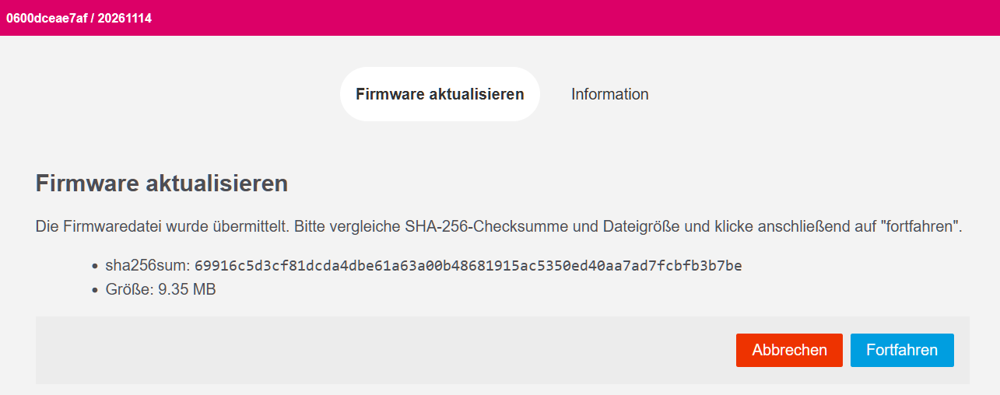

# Mercusys MR90X v1: Freifunk-Firmware installieren

> Schreib uns, ob es geklappt hat. Und wenn es irgendwo hakt: Melde dich,
> wir helfen dir weiter. Jede Rückmeldung macht die
> Anleitung für alle nach dir besser:
>
> [projekt@neanderfunk.de](mailto:projekt@neanderfunk.de?subject=Anleitung%20Mercusys%20MR90X%20v1)

Der Mercusys MR90X v1 nimmt fremde Firmware weder über seine Oberfläche noch über
einen einfachen Notfall-Modus an. Der Weg führt über eine Hintertür in der
Mercusys-Firmware auf die Kommandozeile, von dort kommt die **Gluon-RAMpe** auf den Router, eine kleine Firmware, die
nur eins kann: die Freifunk-Firmware deiner Community annehmen. Die lädst du
dann im Browser hoch. Das ist etwas für Leute,
die mit SSH, scp und einer Shell umgehen können
([SSH und scp benutzen](grundlagen/ssh-scp.md)).

> **Erst sichern, dann ändern.** Bevor du irgendetwas veränderst, sicherst
> du in Schritt 4 die Bereiche `boot` und `tp_data` und den Ordner
> `/tp_data`. Darin stecken unter anderem die MAC-Adresse und die
> Funk-Kalibrierung des Geräts. Ohne diese Sicherungen gibt es keinen
> Rückweg, wenn etwas schiefgeht. Die serielle Konsole hilft dann auch
> nicht ohne Weiteres: Sie ist erst nutzbar, wenn man auf der Platine
> fehlende Widerstände bestückt oder Lötbrücken setzt.

## Was du brauchst

- den Router mit Netzteil, einen Rechner mit Netzwerkanschluss und ein
  Netzwerkkabel
- auf dem Rechner `ssh`, `scp` und `telnet` (unter Windows ist `telnet`
  ein optionales Feature, alternativ PuTTY)
- das Passwort der Mercusys-Oberfläche (beim ersten Aufruf legst du es fest)
- die Installationsdateien als ZIP: [mr90x-v1-installdateien.zip](https://firmware.neanderfunk.de/other/dump/mr90x-v1-installdateien.zip). Pack sie
  aus. Kommt dabei keine Fehlermeldung, sind die Dateien heil. Darin liegen
  ein vollständiges busybox (`busybox-aarch64`; das busybox der
  Mercusys-Firmware kann einen nötigen Befehl nicht), OpenWrt als
  Zwischenstufe (`openwrt-24.10.8-mediatek-filogic-mercusys_mr90x-v1-initramfs-kernel.bin`), Prüfsummen und Hinweise zu den
  Quelltexten. Gebraucht wird daraus nur das busybox.
- die RAMpe für den Mercusys MR90X v1:
  [gluon-rampe-20261115-mercusys-mr90x-v1-initramfs-kernel.bin](https://firmware.neanderfunk.de/other/Gluon-Installer-RAMpe/gluon-rampe-20261115-mercusys-mr90x-v1-initramfs-kernel.bin). Leg sie in denselben Ordner.
- die Freifunk-Firmware deiner Community für den Mercusys MR90X v1, und zwar das
  **sysupgrade**-Image

## Schritte

### Teil 1: Zugang und Sicherungen

1. **Verbinden.** Steck das Kabel vom Rechner in die Buchse **LAN1**. Der
   Rechner bleibt auf "automatisch". Öffne `http://192.168.1.1` und leg das
   Passwort für die Oberfläche fest, falls noch keins gesetzt ist.

2. **Per SSH anmelden.** Benutzer `root`, Port `20001`, Passwort wie in
   der Oberfläche:

   ```
   ssh -p 20001 -o HostKeyAlgorithms=+ssh-rsa root@192.168.1.1
   ```

   Es erscheint eine Shell mit `root@Akronite`.

3. **Startbereich prüfen.**

   ```
   fw_printenv | grep tp_boot_idx
   ```

   Steht dort `tp_boot_idx=1`, spiel zuerst über die Oberfläche die
   Mercusys-Firmware noch einmal ein und fang bei Schritt 2 wieder an.
   Sonst weiter.

4. **Sichern.** Noch in der SSH-Shell:

   ```
   cat /dev/mtd0 > /tmp/boot.bin
   cat /dev/mtd5 > /tmp/tp_data.bin
   chmod 666 /tp_data/MT7986_EEPROM.bin /tp_data/default-mac
   ```

   Dann auf deinem Rechner, in einem zweiten Terminal:

   ```
   mkdir mr90x-sicherung
   scp -O -P 20001 -o HostKeyAlgorithms=+ssh-rsa root@192.168.1.1:/tmp/boot.bin mr90x-sicherung/
   scp -O -P 20001 -o HostKeyAlgorithms=+ssh-rsa root@192.168.1.1:/tmp/tp_data.bin mr90x-sicherung/
   scp -O -P 20001 -o HostKeyAlgorithms=+ssh-rsa -r root@192.168.1.1:/tp_data mr90x-sicherung/
   ```

   scp fragt jedes Mal nach dem Passwort.

   **Prüfen:** `boot.bin` ist 2 MiB groß (2.097.152 Bytes), `tp_data.bin`
   4 MiB (4.194.304 Bytes), und im Ordner `tp_data` liegen
   `MT7986_EEPROM.bin` und `default-mac`. Leg die Sicherung an einen
   sicheren Ort. Ohne sie nicht weitermachen.

### Teil 2: Telnet über die IPTV-Einstellung

5. **Telnet vorbereiten.** Die Datei `/etc/hotplug.d/iface/65-iptv`
   bekommt direkt nach der ersten Zeile (`#!/bin/sh`) die Zeile
   `telnetd -l /bin/login.sh`. In der SSH-Shell:

   ```
   sed -i '1a telnetd -l /bin/login.sh' /etc/hotplug.d/iface/65-iptv
   head -n 3 /etc/hotplug.d/iface/65-iptv
   ```

   Die Ausgabe zeigt oben `#!/bin/sh`, darunter die neue Zeile. Wer lieber
   mit WinSCP arbeitet, kann die Datei auch dort bearbeiten.

6. **Auslösen.** Schalte in der Mercusys-Oberfläche die Einstellung
   **"IPTV/VLAN Enable"** um und speichere. Prüf in der SSH-Shell, ob jetzt
   ein Telnet-Dienst läuft:

   ```
   netstat -ltunp | grep 23
   ```

7. **Per Telnet anmelden.** Auf deinem Rechner:

   ```
   telnet 192.168.1.1
   ```

   Ohne Benutzer und Passwort erscheint `root@Akronite:/#`. Die weiteren
   Befehle tippst du in diese Telnet-Shell.

### Teil 3: Die RAMpe als Zwischenstufe

8. **Dateien auf den Router.** Auf deinem Rechner, im ausgepackten Ordner:

   ```
   scp -O -P 20001 -o HostKeyAlgorithms=+ssh-rsa busybox-aarch64 gluon-rampe-20261115-mercusys-mr90x-v1-initramfs-kernel.bin root@192.168.1.1:/tmp/
   ```

   In der Telnet-Shell:

   ```
   cd /tmp
   chmod a+x busybox-aarch64
   du -h gluon-rampe-20261115-mercusys-mr90x-v1-initramfs-kernel.bin
   ```

   Die Größe muss kleiner sein als 9MiB.

9. **Die RAMpe schreiben.** Ab hier ist die Mercusys-Firmware weg. Der
   Notfall-Modus des Bootloaders bleibt aber erhalten (siehe "Zurück zur
   Mercusys-Firmware").

   ```
   ubirmvol /dev/ubi0 -N kernel
   ubimkvol /dev/ubi0 -n 1 -N kernel -s 9MiB
   ./busybox-aarch64 ubiupdatevol /dev/ubi0_1 /tmp/gluon-rampe-20261115-mercusys-mr90x-v1-initramfs-kernel.bin
   reboot
   ```

### Teil 4: Freifunk-Firmware

Nach dem Neustart läuft die RAMpe unter `192.168.1.1`, der Rechner bleibt
auf "automatisch". Die Einstellungen des Bootloaders, die OpenWrt sonst
braucht, setzt die RAMpe vor dem Schreiben selbst.

10. **Die RAMpe-Seite öffnen.** Öffne `http://192.168.1.1`. Die RAMpe
    leitet von selbst auf ihre Seite "Firmware aktualisieren" weiter. Kommt
    stattdessen "Not Found", hat sich der Browser eine Weiterleitung von
    früher gemerkt, siehe [Der Browser zeigt "Not Found"](grundlagen/browser-not-found.md).
    Kommt gar nichts, siehe [Die Router-Seite antwortet nicht](grundlagen/router-antwortet-nicht.md).
    Zeigt der Browser eine Warnung vor einem unsicheren Zertifikat, hat er
    von sich aus `https://` vor die Adresse gesetzt, siehe
    [Browser macht https daraus](grundlagen/browser-https.md).
    Die RAMpe bleibt auf dem Router, bis die Freifunk-Firmware sie ersetzt.
    Startet der Router zwischendurch neu, ist das harmlos: Seite einfach
    wieder aufrufen.

    

11. **Freifunk-Firmware hochladen.** Wähl das **sysupgrade**-Image
    deiner Community aus und klick "Datei hochladen". Die RAMpe zeigt die
    Prüfsumme (SHA256) der Datei. Vergleich sie mit der Prüfsumme, die deine
    Community zur Datei angibt. Stimmt sie, klick "Fortfahren".

    

    Danach erscheint der Hinweis, dass die Firmware jetzt geschrieben wird.
    Jetzt den Strom nicht unterbrechen.

    

12. **Fertig.** Der Router schreibt die Firmware und startet neu, einige
    Minuten. **Strom nicht ziehen.** Danach startet die Freifunk-Firmware
    deiner Community: je nach Community zuerst mit einer Einrichtungsseite
    unter `http://192.168.1.1` oder gleich im Betrieb.
    Antwortet dort nichts, siehe [Die Router-Seite antwortet
    nicht](grundlagen/router-antwortet-nicht.md); kommt "Not Found", siehe
    [Der Browser zeigt "Not Found"](grundlagen/browser-not-found.md).

## Woran du erkennst, dass es geklappt hat

- Nach Schritt 4 liegen `boot.bin`, `tp_data.bin` und der Ordner `tp_data`
  in der richtigen Größe auf deinem Rechner.
- Nach Schritt 9 zeigt `http://192.168.1.1` die RAMpe-Seite "Firmware
  aktualisieren".
- Nach Schritt 12 meldet sich die Freifunk-Firmware.

## Wenn etwas schiefgeht

- **ssh meldet "no matching host key type found".** Der Router kennt nur
  alte Verfahren. Die Option `-o HostKeyAlgorithms=+ssh-rsa` muss dabei
  sein. Manche Linux-Systeme lehnen zusätzlich SHA-1 ab; dann hilft der
  Hinweis im Abschnitt "Notes" des OpenWrt-Wikis.
- **scp meldet "sftp-server: not found" o. ä.** Das `-O` fehlt.
- **Nach dem Umschalten von "IPTV/VLAN Enable" läuft kein Telnet.** Prüf,
  ob die Zeile in `65-iptv` direkt unter `#!/bin/sh` steht, und schalte die
  Einstellung noch einmal um.
- **Nach Schritt 9 startet der Router nicht.** Über den Notfall-Modus
  zurück zur Mercusys-Firmware (unten) und von vorn.

## Anderer Weg: über OpenWrt

Statt der RAMpe geht in Schritt 8 und 9 auch das OpenWrt aus der ZIP
(`openwrt-24.10.8-mediatek-filogic-mercusys_mr90x-v1-initramfs-kernel.bin`), mit denselben Befehlen und diesem Dateinamen.
Nach dem Neustart läuft OpenWrt unter `192.168.1.1`. Dann setzt du die
Einstellungen des Bootloaders selbst: `ssh root@192.168.1.1` (normaler
Port, kein Passwort) und genau diese Befehle:

```
fw_setenv baudrate 115200
fw_setenv bootargs "ubi.mtd=ubi0 console=ttyS0,115200n1 loglevel=8 earlycon=uart8250,mmio32,0x11002000 init=/etc/preinit"
fw_setenv fdtcontroladdr 5ffc0e70
fw_setenv ipaddr 192.168.1.1
fw_setenv loadaddr 0x46000000
fw_setenv mtdids "spi-nand0=spi-nand0"
fw_setenv mtdparts "spi-nand0:2M(boot),1M(u-boot-env),50M(ubi0),50M(ubi1),8M(userconfig),4M(tp_data)"
fw_setenv netmask 255.255.255.0
fw_setenv serverip 192.168.1.2
fw_setenv stderr serial@11002000
fw_setenv stdin serial@11002000
fw_setenv stdout serial@11002000
fw_setenv tp_boot_idx 0
```

Danach das sysupgrade-Image mit `scp -O <sysupgrade-image>
root@192.168.1.1:/tmp/sysupgrade.bin` kopieren und auf dem Router
`sysupgrade -n /tmp/sysupgrade.bin` eingeben.

## Zurück zur Mercusys-Firmware

Der Bootloader von Mercusys bleibt bei diesem Weg unangetastet, sein
Notfall-Modus also auch:

1. Rechner fest auf `192.168.1.2`, Netzmaske `255.255.255.0`
   ([Feste IP-Adresse einstellen](grundlagen/feste-ip.md)), Kabel an LAN1.
2. Reset-Taste drücken, Strom einstecken, nach etwa 10 Sekunden loslassen.
3. Im Browser `http://192.168.1.1` öffnen und die Mercusys-Firmware
   hochladen ([Download bei Mercusys](https://www.mercusys.com/de/download/mr90x)).

Stimmen danach MAC-Adresse oder Funk nicht, schreibst du `tp_data` aus
deiner Sicherung zurück. Wie das geht, beschreibt das OpenWrt-Wiki im
Abschnitt "Return to stock".
